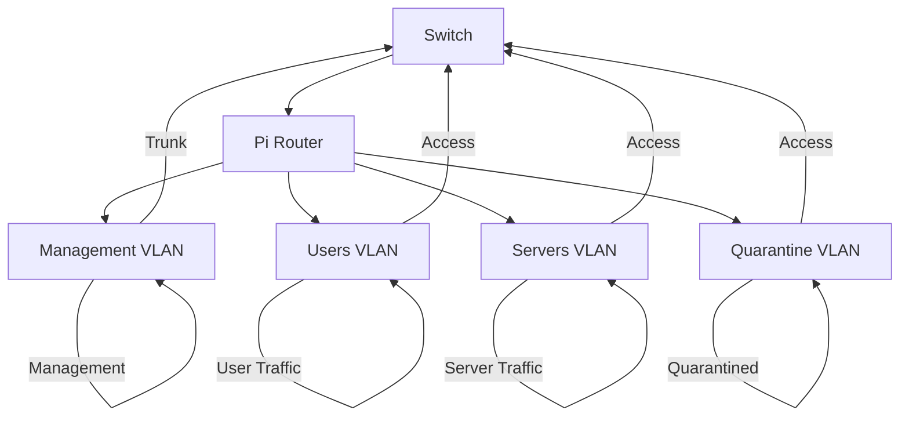

# VLAN Lab README

This lab demonstrates a VLAN configuration using a Cisco WS-C2960CG-8TC-L switch and a Raspberry Pi 5 acting as a router-on-a-stick. The lab includes four VLANs: Management, Users, Servers, and Quarantine.

## Topology Diagram

## VLANs

| VLAN Name   | Subnet         | Gateway       | Purpose           |
|------------|---------------|---------------|------------------|
| Management  | 10.10.1.0/24  | 10.10.1.1     | Management traffic |
| Users       | 10.10.2.0/24  | 10.10.2.1     | User traffic      |
| Servers     | 10.10.3.0/24  | 10.10.3.1     | Server traffic    |
| Quarantine  | 10.10.4.0/24  | 10.10.4.1     | Quarantined devices |

## Configuration Files

- `addressing.md`: VLAN addressing plan
- `switch-2960cg.txt`: Cisco switch configuration
- `pi-router.md`: Raspberry Pi router configuration
- `tests.md`: Test checklist

This lab provides a secure and controlled network environment for your VLANs. Let me know if you need any further assistance!